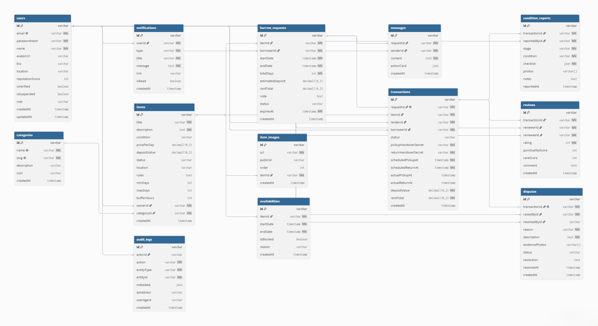
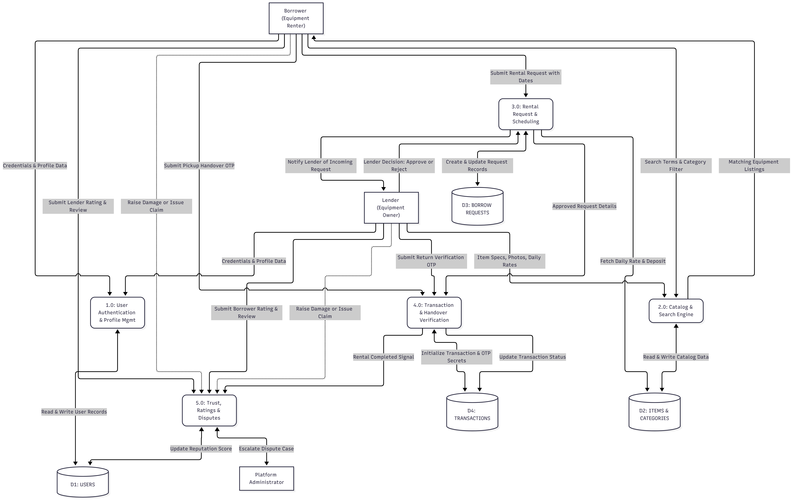
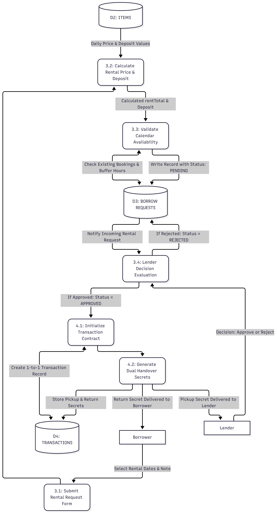
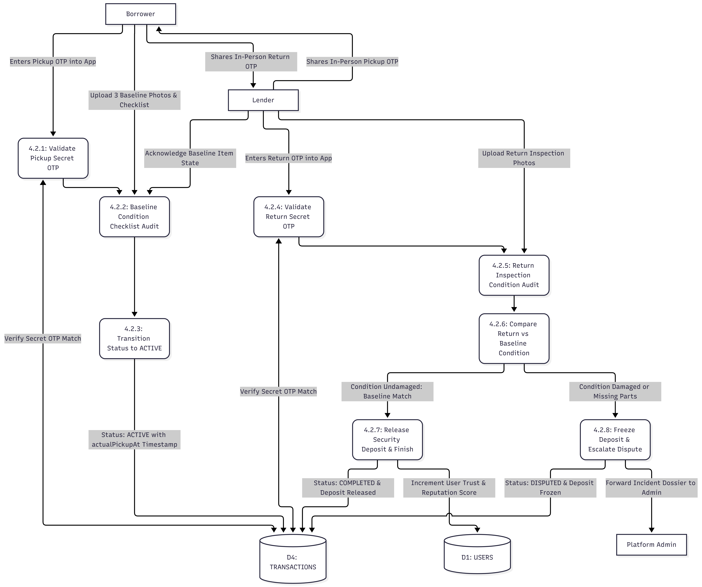

# BorrowNet

BorrowNet is a peer-to-peer resource and equipment sharing platform built with a modern React frontend and Express/PostgreSQL backend.

## Overview

BorrowNet enables community members to lend and borrow tools, electronics, and equipment safely:

- **Interactive Catalog**: Search, filter by category, and browse equipment with transparent pricing, lender trust ratings, and security deposits.
- **Dual-Theme Design System**: High-contrast, clean light and dark modes built with Tailwind CSS.
- **Secure Authentication**: Role-based access control, session handling, and encrypted credentials.
- **RESTful Architecture**: Clean `/api/v1` routes with request IDs and structured response envelopes.

## Tech Stack

- **Frontend**: React 18, Vite, Tailwind CSS, Lucide Icons, TanStack Query
- **Backend**: Node.js, Express, Prisma ORM
- **Database**: PostgreSQL
- **Caching & Rate Limiting**: Redis

## System Architecture & Diagrams

<details>
  <summary><b>📊 Click to view Entity-Relationship (ER) Diagram</b></summary>
  <br>
  <p>Illustrates database schema entities, attributes, primary/foreign keys, and cardinalities across users, equipment items, categories, borrow requests, transactions, and reviews.</p>
  
</details>

<br>

<details>
  <summary><b>🔄 Click to view Data Flow Diagrams (DFD Levels 1, 2, 3)</b></summary>
  <br>
  <h4>Level 1 DFD: High-Level System Processes</h4>
  <p>Captures data flows between external entities (Borrower, Lender, Admin), core application processes (Authentication, Catalog Discovery, Transaction Management), and persistent data stores.</p>
  
  
  <hr>

  <h4>Level 2 DFD: Borrowing & Transaction Lifecycle</h4>
  <p>Breaks down sub-processes for rental requests, lender approvals, security deposit escrow, and item handover.</p>
  
  
  <hr>

  <h4>Level 3 DFD: Detailed Execution & Settlement</h4>
  <p>Depicts granular state validation, return verification, deposit release/refund settlement, and review logging.</p>
  
</details>

## Getting Started

### Prerequisites

- Node.js 20+
- PostgreSQL
- Redis

### Installation & Setup

1. **Install dependencies**:

   ```bash
   npm install
   ```

2. **Configure environment variables**:

   ```bash
   cp apps/api/.env.example apps/api/.env
   ```

3. **Run database migrations**:

   ```bash
   npm run db:migrate --workspace apps/api
   ```

4. **Start development servers**:
   ```bash
   npm run dev
   ```

- Frontend: `http://localhost:5173`
- Backend API: `http://localhost:5000`
- API Health Check: `http://localhost:5000/api/v1/health`

## Validation & Testing

```bash
npm run check
npm test
```
